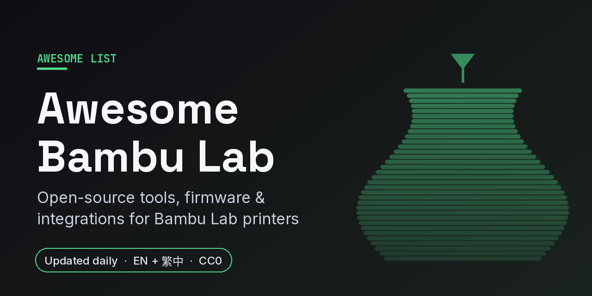

# Awesome Bambu Lab 

   

English | [繁體中文](README.zh-TW.md)

> A curated map of the open-source ecosystem around Bambu Lab 3D printers: LAN control, Home Assistant, firmware, slicers, farms, filament and cameras.

**Status:** Curated 2026-10. Contributions welcome.

**Disclaimer:** Unofficial, not affiliated with Bambu Lab. Custom firmware and hardware mods **may void your warranty** and can damage hardware; some firmware projects have licensing questions, check each project's license yourself. Use at your own risk.

---

## Start here

The projects people actually share. Everything below is the map around them, not a product catalog.

- **[X1Plus](https://github.com/X1Plus/X1Plus)** — Community custom firmware for the X1 / X1 Carbon.
- **[bambuddy](https://github.com/maziggy/bambuddy)** — Self-hosted, cloud-free command center for Bambu printers.
- **[ha-bambulab](https://github.com/greghesp/ha-bambulab)** — Home Assistant integration for Bambu Lab printers.
- **[OpenBambuAPI](https://github.com/Doridian/OpenBambuAPI)** — Community documentation of the Bambu printer APIs.
- **[RFID-Tag-Guide](https://github.com/Bambu-Research-Group/RFID-Tag-Guide)** — How to read Bambu filament NFC/RFID tags.

---

## New this week

Added between 2026-10-20 and 2026-10-26 (derived from git history).

- **[bambu-lan-cli](https://github.com/zxy8060/bambu-lan-cli)** — Experimental Python CLI for file checks, Bambu Studio CLI slicing, LAN status and signed print sending with AMS or external spool; you supply your own authorized signing identity. _(LAN mode, APIs & libraries)_
- **[universal-3d-cards](https://github.com/Rein033/universal-3d-cards)** — Home Assistant dashboard card for Bambu Lab and other printers, with a drawn printer, live camera and AMS spools in their real colours. _(Home Assistant & automation)_
- **[3d-printdash](https://github.com/Freaky-Jay-22/3d-printdash)** — Local Home Assistant app or Docker dashboard for Bambu Lab and Klipper printers with built-in filament manager, cameras and print history. _(Home Assistant & automation)_
- **[bambuddy-dragonbreath](https://github.com/rmonk/bambuddy-dragonbreath)** — Sidecar that turns a Panda Breath chamber heater (DragonBreath firmware) on and off from Bambuddy print events, picking the temperature from the filaments the print uses. _(Home Assistant & automation)_
- **[bambu-dashboard-card](https://github.com/kai-wei-kfuse/bambu-dashboard-card)** — Multi-printer Home Assistant dashboard card built on ha-bambulab, with camera, controls, AMS spools and a project browser; first public release v0.1.0, still early. _(Home Assistant & automation)_
- **[3D Print Cost](https://github.com/ZoziLaMalice/ha-3d-print-cost)** — Home Assistant integration that works out the electricity and filament cost of every Bambu Lab print. _(Home Assistant & automation)_
- **[ReBLLED](https://github.com/brossow/ReBLLED)** — Alternative firmware for the BLLED ESP32 LED controller that lights the chamber automatically and shows print status. _(Firmware & hardware mods)_
- **[PausePalette](https://github.com/DanaLeeTech/PausePalette)** — Plans colour order and inserts spool-swap pauses so you can print more colours than your AMS has slots. _(Slicers, profiles & G-code)_
- **[pandy-slicer](https://github.com/gccammelli/pandy-slicer)** — Bambu Studio's CLI slicer as a Home Assistant add-on or Docker container, so the Pandy app can print MakerWorld models in LAN-only mode. _(Slicers, profiles & G-code)_

19 more added this week

- **[bambu-tui](https://github.com/cliffom/bambu-tui)** — Terminal UI for watching a Bambu Lab print farm: printer status, progress, time left, temperatures, filament and faults on one screen. _(Print farms & queues)_
- **[bambu-spoolman-autoadd](https://github.com/Satal/bambu-spoolman-autoadd)** — Small service that creates Bambu RFID spools in Spoolman as soon as they are loaded into an AMS tray, via ha-bambulab in Home Assistant; works in cloud mode, no LAN mode needed. _(Filament, AMS & RFID)_
- **[BridgeBox](https://github.com/J0eB0l/BridgeBox)** — Small board that connects a stock Bambu AMS (AMS 1, AMS 2 Pro, AMS HT, AMS Lite) to a Klipper printer through AFC-Klipper-Add-On, without opening the AMS or changing its firmware. _(Filament, AMS & RFID)_
- **[Bambu OLED Info](https://github.com/Asimmimx/bambu-oled-info)** — ESP32-C3 desk gadget with a small OLED and rotary knob that shows live printer status over local MQTT or your Bambu account; read-only. _(Dashboards, displays & apps)_
- **[PrintCtrl](https://github.com/VoidedKN0X/PrintCtrl)** — Telemetry-free Android app for self-hosted Bambuddy and Spoolman servers, covering your Bambu printers and filament spools. _(Dashboards, displays & apps)_
- **[Tiger Touch](https://github.com/TigerTag-Project/Tiger-Touch)** — Free open-source firmware that turns the BIGTREETECH Panda Touch / K-Touch into one touchscreen for Bambu Lab and other brands' printers, plus Klipper and OctoPrint. _(Dashboards, displays & apps)_
- **[xTouch-CN](https://github.com/tbc0309/xTouch-CN)** — Independently maintained multilingual fork of xtouch for ESP32-2432S028R and Waveshare ESP32-S3/P4 boards, with web flashing, AMS management and camera on S3/P4. _(Dashboards, displays & apps)_
- **[BambuDeck](https://github.com/Ripwords/BambuDeck)** — Self-hosted mobile PWA for Bambu printers in LAN mode: prints, cameras, toolpath layer preview, file browser, AMS filament and Home Assistant MQTT Discovery; runs in Docker. _(Dashboards, displays & apps)_
- **[Layerwatch](https://github.com/d01/layerwatch)** — Android app to watch and control Bambu printers directly over your own network, with live camera and lock-screen alerts; no cloud account, ads or tracking. _(Dashboards, displays & apps)_
- **[BambuBar](https://github.com/kopytjuk/bambubar)** — macOS menu bar app showing live print progress, time left, temperatures and AMS humidity over local MQTT. _(Dashboards, displays & apps)_
- **[Bambu Bar](https://github.com/rolottr/bambu-bar)** — Native macOS menu bar app and desktop widgets for several Bambu printers over LAN, with a 3D printer model, AMS grams left, print controls and notifications; no account or cloud. _(Dashboards, displays & apps)_
- **[Bambu Bar for Windows](https://github.com/bhex/bambu-bar-windows)** — Native Windows tray port of Bambu Bar for P2-series printers, with live status, AMS filament and pause, resume, stop and speed controls over the printer's MQTT; no cloud or account. _(Dashboards, displays & apps)_
- **[bambu-monitor](https://github.com/koevetmc/bambu-monitor)** — Lightweight Linux system-tray monitor with desktop notifications and pause, resume, stop and light controls over local MQTT; no cloud or account. _(Dashboards, displays & apps)_
- **[BambuDroid](https://github.com/kuaner/bambuDroid)** — Native Android LAN print dashboard for Bambu printers, built for non-touch screens and Bluetooth remotes; no cloud account. _(Dashboards, displays & apps)_
- **[PrintWatch LAN](https://github.com/MJNProjekts/printwatch-lan)** — Telegram notifications, camera snapshots and remote control for Bambu P1/A1 printers in LAN-only mode, through your own Telegram bot; public beta. _(Dashboards, displays & apps)_
- **[bamboozle](https://github.com/nxmxbbd/bamboozle)** — LAN-only Apple Home bridge that shows a Bambu printer's progress, status and camera in HomeKit, without Home Assistant or Homebridge. _(Bridges & AI agents)_
- **[printshop-mcp](https://github.com/FireBall1725/printshop-mcp)** — MCP server for Bambuddy and Spoolman so an AI agent can check filament stock, send a sliced 3MF and watch the job. _(Bridges & AI agents)_
- **[bambustudio-mcp](https://github.com/subhashdasyam/bambustudio-mcp)** — MCP server for the Bambu Studio slicer to inspect parts, configure saved 3MF projects and compare slices from Claude Code or Codex. _(Bridges & AI agents)_
- **[bambu-sentinel-mcp](https://github.com/selcukgk29/bambu-sentinel-mcp)** — LAN-only MCP server for Bambu printers with live control, a filament-aware job queue across a fleet and print monitoring. _(Bridges & AI agents)_

---

## Contents

- [At a glance](#at-a-glance)
- [Official open source (bambulab)](#official-open-source-bambulab)
- [LAN mode, APIs & libraries](#lan-mode-apis--libraries)
- [Home Assistant & automation](#home-assistant--automation)
- [Firmware & hardware mods](#firmware--hardware-mods)
- [Slicers, profiles & G-code](#slicers-profiles--g-code)
- [Print farms & queues](#print-farms--queues)
- [Filament, AMS & RFID](#filament-ams--rfid)
- [Camera & timelapse](#camera--timelapse)
- [Dashboards, displays & apps](#dashboards-displays--apps)
- [Bridges & AI agents](#bridges--ai-agents)
- [Closed-source / commercial (for reference)](#closed-source--commercial-for-reference)
- [Related lists](#related-lists)
- [Contributing](#contributing)
- [License](#license)

---

## At a glance

### LAN or cloud?

Whether a tool talks to the printer on your local network or through Bambu Cloud, as stated in each project's README or docs on 2026-10-21. Bambu firmware updates can change what third-party tools may do, so check the project before relying on it.

| Project | Local network (LAN) | Bambu Cloud |
|---|---|---|
| [ha-bambulab](https://github.com/greghesp/ha-bambulab) | Yes: LAN Mode setup with printer IP and access code | Yes: the [setup docs](https://github.com/greghesp/ha-bambulab/blob/main/docs/setup.mdx) recommend cloud credentials for the most features |
| [bambuddy](https://github.com/maziggy/bambuddy) | Yes: Developer Mode, works offline | Optional: profile management through your Bambu Cloud login |
| [bambu-gateway](https://github.com/leolobato/bambu-gateway) | Yes: default mode, needs Developer Mode | Optional: experimental cloud mode |
| [PrintGlance](https://github.com/talic/PrintGlance) | Yes: read-only, over Wi-Fi with the access code | Not needed, no account |
| [bambu-connect](https://github.com/mattcar15/bambu-connect) | Yes: printer IP and access code | Not mentioned |
| [bambu-proxy](https://github.com/disconn3ct/bambu-proxy) | Yes: local MQTT relay so many clients share one printer | Not mentioned |
| [bambu-farm](https://github.com/ellenhp/bambu-farm) | Yes: built for LAN mode | Replaces it with a self-hosted service; README says not ready for general use |

## Official open source (bambulab)

- **[BambuStudio](https://github.com/bambulab/BambuStudio)** — Official slicer (open source).

## LAN mode, APIs & libraries

- **[OpenBambuAPI](https://github.com/Doridian/OpenBambuAPI)** — API documentation.
- **[bambulabs_api](https://github.com/BambuTools/bambulabs_api)** — Unofficial Python API.
- **[bambulabs_api](https://github.com/torbenconto/bambulabs_api)** — Unofficial Go bindings.
- **[bambulab](https://github.com/markhaehnel/bambulab)** — Rust API client crate.
- **[pybambu](https://github.com/greghesp/pybambu)** — Python library used by the HA integration.
- **[bambu-printer-manager](https://github.com/synman/bambu-printer-manager)** — Pure-Python printer manager library.
- **[bambu-connect](https://github.com/mattcar15/bambu-connect)** — Stats, controls and camera access.
- **[Bambu-Lab-Cloud-API](https://github.com/coelacant1/Bambu-Lab-Cloud-API)** — Analysis of the Bambu cloud API.
- **[open-bamboo-networking](https://github.com/ClusterM/open-bamboo-networking)** — Open replacement for Bambu Studio's proprietary network plugin.
- **[bambu-farm](https://github.com/ellenhp/bambu-farm)** — Self-hostable Bambu Cloud alternative.
- **[open-bambu-networking-plugin](https://github.com/persano/open-bambu-networking-plugin)** — Open-source OrcaSlicer networking plugin: cloud printing, remote liveview, AMS sync.
- **[bambu-proxy](https://github.com/disconn3ct/bambu-proxy)** — MQTT proxy that multiplexes many clients onto one Bambu printer connection.
- **[bambulab-virtual-printer](https://github.com/tbc0309/bambulab-virtual-printer)** — Local Bambu printer and AMS MQTT simulator with a web dashboard, for testing clients without a real printer.
- **[bambu-lan-cli](https://github.com/zxy8060/bambu-lan-cli)** — Experimental Python CLI for file checks, Bambu Studio CLI slicing, LAN status and signed print sending with AMS or external spool; you supply your own authorized signing identity.

## Home Assistant & automation

- **[ha-bambulab](https://github.com/greghesp/ha-bambulab)** — Home Assistant integration.
- **[ha-bambu-lab-p1-spaghetti-detection](https://github.com/nberktumer/ha-bambu-lab-p1-spaghetti-detection)** — Spaghetti detection integration.
- **[Bambu-HomeAssistant-Flows](https://github.com/WolfwithSword/Bambu-HomeAssistant-Flows)** — HA dashboards and Node-RED flows.
- **[printwatch-card](https://github.com/drkpxl/printwatch-card)** — HA dashboard card for printer monitoring.
- **[SpoolmanSync](https://github.com/gibz104/SpoolmanSync)** — Automatic Spoolman tracking via HA.
- **[HA-Panda-PWR](https://github.com/62fixolab/HA-Panda-PWR)** — Home Assistant integration for the BIGTREETECH Panda PWR smart plug.
- **[homeassistant-app-bambuddy](https://github.com/Spegeli/homeassistant-app-bambuddy)** — BamBuddy packaged as a Home Assistant App (Supervisor).
- **[ha-bambulab-blueprints](https://github.com/pleasantone/ha-bambulab-blueprints)** — Home Assistant blueprints for filter wear tracking, auto power-down, chamber heater safety and print notifications.
- **[universal-3d-cards](https://github.com/Rein033/universal-3d-cards)** — Home Assistant dashboard card for Bambu Lab and other printers, with a drawn printer, live camera and AMS spools in their real colours.
- **[3d-printdash](https://github.com/Freaky-Jay-22/3d-printdash)** — Local Home Assistant app or Docker dashboard for Bambu Lab and Klipper printers with built-in filament manager, cameras and print history.
- **[bambuddy-dragonbreath](https://github.com/rmonk/bambuddy-dragonbreath)** — Sidecar that turns a Panda Breath chamber heater (DragonBreath firmware) on and off from Bambuddy print events, picking the temperature from the filaments the print uses.
- **[bambu-dashboard-card](https://github.com/kai-wei-kfuse/bambu-dashboard-card)** — Multi-printer Home Assistant dashboard card built on ha-bambulab, with camera, controls, AMS spools and a project browser; first public release v0.1.0, still early.
- **[3D Print Cost](https://github.com/ZoziLaMalice/ha-3d-print-cost)** — Home Assistant integration that works out the electricity and filament cost of every Bambu Lab print.

## Firmware & hardware mods

- **[X1Plus](https://github.com/X1Plus/X1Plus)** — Custom firmware for X1 / X1C.
- **[Bambu-Lab-Klipper-Conversion](https://github.com/ChazLayyd/Bambu-Lab-Klipper-Conversion)** — Run Klipper by replacing the internal electronics.
- **[BMCU-C-PJARCZAK](https://github.com/jarczakpawel/BMCU-C-PJARCZAK)** — BMCU 370C firmware for A1 / A1 mini / P1S.
- **[Bambu-Bus](https://github.com/Bambu-Research-Group/Bambu-Bus)** — Tools and docs on the Bambu Bus.
- **[x1-expander](https://github.com/jwise/x1-expander)** — Expander board for the X1 Carbon.
- **[OpenBL](https://github.com/opensourcemanufacturing/OpenBL)** — Exploration of printer hardware and firmware.
- **[bambu-cuts](https://github.com/unrelatedlabs/bambu-cuts)** — Cutter and plotter for the A1 mini.
- **[BambuScribe](https://github.com/Animesh-Varma/BambuScribe)** — Turn a Bambu Lab printer into a pen plotter with safe custom G-code (no slicer hacks).
- **[Bambu-Poop-Conveyor-ESP32](https://github.com/t0nyz0/Bambu-Poop-Conveyor-ESP32)** — ESP32 waste conveyor with MQTT automation.
- **[PandaStatusOS](https://github.com/jeremykenedy/PandaStatusOS)** — Clean-room open firmware for the BIGTREETECH Panda Status P2 LED bar.
- **[ReBLLED](https://github.com/brossow/ReBLLED)** — Alternative firmware for the BLLED ESP32 LED controller that lights the chamber automatically and shows print status.

## Slicers, profiles & G-code

- **[OrcaSlicer](https://github.com/OrcaSlicer/OrcaSlicer)** — Open-source slicer with first-class Bambu support.
- **[OrcaSlicer-bambulab](https://github.com/FULU-Foundation/OrcaSlicer-bambulab)** — OrcaSlicer variant focused on Bambu printers.
- **[OrcaStudio](https://github.com/jarczakpawel/OrcaStudio)** — Bambu Studio fork with OrcaSlicer changes.
- **[bambulab-studio-orca-slicer-presets](https://github.com/DRIgnazGortngschirl/bambulab-studio-orca-slicer-presets)** — Community presets collection.
- **[Bambu_CustomGCode](https://github.com/eukatree/Bambu_CustomGCode)** — Custom G-code for Bambu Studio.
- **[Filament_Calibration_Wizard](https://github.com/Django1982/Filament_Calibration_Wizard)** — Filament calibration helper for Orca and Bambu Studio.
- **[Bricklayers](https://github.com/TengerTechnologies/Bricklayers)** — Brick-layer post-processing script.
- **[StudioBridge](https://github.com/Rdiger-36/StudioBridge)** — Adds printers from other accounts to Bambu Studio.
- **[docker-orcaslicer](https://github.com/linuxserver/docker-orcaslicer)** — OrcaSlicer in a browser-accessible container.
- **[docker-bambustudio](https://github.com/linuxserver/docker-bambustudio)** — Bambu Studio in a browser-accessible container.
- **[layer-rescue](https://github.com/EmirhanSyl/layer-rescue)** — Bambu Studio post-processing script to resume a failed print from any layer.
- **[preset-porter](https://github.com/OMRITGM/preset-porter)** — Browser tool that fixes Bambu Studio filament presets that become "Unsupported" after switching printers.
- **[shambu](https://github.com/Shavvimal/shambu)** — CLI and Claude Code plugin to build, inspect and patch Bambu Studio .3mf projects and slice headless.
- **[PausePalette](https://github.com/DanaLeeTech/PausePalette)** — Plans colour order and inserts spool-swap pauses so you can print more colours than your AMS has slots.
- **[pandy-slicer](https://github.com/gccammelli/pandy-slicer)** — Bambu Studio's CLI slicer as a Home Assistant add-on or Docker container, so the Pandy app can print MakerWorld models in LAN-only mode.

## Print farms & queues

- **[bambuddy](https://github.com/maziggy/bambuddy)** — Self-hosted command center.
- **[bambu-farm](https://github.com/TFyre/bambu-farm)** — Web interface for multiple printers.
- **[fdm-monster](https://github.com/fdm-monster/fdm-monster)** — Printer farm management platform.
- **[print-farm-manager](https://github.com/joeltelling/print-farm-manager)** — Multi-brand self-hosted farm manager.
- **[bambu-gateway](https://github.com/leolobato/bambu-gateway)** — Self-hosted LAN web app and REST API to monitor and print on Bambu printers.
- **[fabrica](https://github.com/wsturner88/fabrica)** — Local multi-brand print farm dashboard with cameras, AMS spool control and MCP tools for AI agents.
- **[bambu-tui](https://github.com/cliffom/bambu-tui)** — Terminal UI for watching a Bambu Lab print farm: printer status, progress, time left, temperatures, filament and faults on one screen.

## Filament, AMS & RFID

- **[RFID-Tag-Guide](https://github.com/Bambu-Research-Group/RFID-Tag-Guide)** — Reading the filament tags.
- **[Bambu-Lab-RFID-Library](https://github.com/queengooborg/Bambu-Lab-RFID-Library)** — Library of filament tag scans.
- **[OpenSpool](https://github.com/spuder/OpenSpool)** — Open RFID for filament spools.
- **[openspoolman](https://github.com/drndos/openspoolman)** — Spoolman with Bambu NFC tags.
- **[bambu-spoolman](https://github.com/mrkirby153/bambu-spoolman)** — Bambu integration for Spoolman.
- **[HaspelSync](https://github.com/Rdiger-36/HaspelSync)** — Track filament consumption.
- **[flipper-bambu](https://github.com/uzyn/flipper-bambu)** — Flipper Zero NFC parser for Bambu filament.
- **[bambu-spoolman-bridge](https://github.com/Yarasarda/bambu-spoolman-bridge)** — Tracks third-party filament usage in Spoolman without switching to LAN-only mode.
- **[TigerTag-Studio-Manager](https://github.com/TigerTag-Project/TigerTag-Studio-Manager)** — Desktop printer and filament manager for the TigerTag open NFC standard.
- **[TigerSpool-RFID](https://github.com/TigerTag-Project/TigerSpool-RFID)** — ESP32 + PN532 RFID spool scanner that assigns filament to printer slots.
- **[bambu-ams-spool-sync](https://github.com/demonkazuya/bambu-ams-spool-sync)** — Home Assistant integration that pushes Spoolman Sync spool assignments to Bambu AMS trays.
- **[bambu-spoolman-autoadd](https://github.com/Satal/bambu-spoolman-autoadd)** — Small service that creates Bambu RFID spools in Spoolman as soon as they are loaded into an AMS tray, via ha-bambulab in Home Assistant; works in cloud mode, no LAN mode needed.
- **[BridgeBox](https://github.com/J0eB0l/BridgeBox)** — Small board that connects a stock Bambu AMS (AMS 1, AMS 2 Pro, AMS HT, AMS Lite) to a Klipper printer through AFC-Klipper-Add-On, without opening the AMS or changing its firmware.

## Camera & timelapse

- **[BambuP1Streamer](https://github.com/slynn1324/BambuP1Streamer)** — MJPEG stream for P1 printers.
- **[bambu-go2rtc](https://github.com/synman/bambu-go2rtc)** — go2rtc MJPEG streamer.
- **[BambuSource2Raw](https://github.com/hisptoot/BambuSource2Raw)** — Raw webcam stream from X1 / P1P.
- **[BambuCAM](https://github.com/BangerTech/BambuCAM)** — Web app for monitoring multiple printer cameras.

## Dashboards, displays & apps

- **[BambuHelper](https://github.com/Keralots/BambuHelper)** — ESP32 desk monitor over MQTT.
- **[PrintSphere](https://github.com/cptkirki/PrintSphere)** — Round ESP32-S3 status companion.
- **[CYD-Klipper](https://github.com/suchmememanyskill/CYD-Klipper)** — Wireless status display (Klipper / Bambu / OctoPrint).
- **[BambUI](https://github.com/fidoriel/BambUI)** — Open UI for LAN mode.
- **[openbu](https://github.com/cygnusx-1-org/openbu)** — Android app for Developer Mode.
- **[panda-be-free](https://github.com/MiguelSchulz/panda-be-free)** — Open-source iOS printer dashboard.
- **[BambuBoard](https://github.com/t0nyz0/BambuBoard)** — Near real-time web dashboard.
- **[Bambulabs-Exporter](https://github.com/Aetrius/Bambulabs-Exporter)** — Prometheus exporter.
- **[xtouch](https://github.com/xperiments-in/xtouch)** — ESP32 touchscreen firmware for controlling and monitoring Bambu Lab printers.
- **[Bambu OLED Info](https://github.com/Asimmimx/bambu-oled-info)** — ESP32-C3 desk gadget with a small OLED and rotary knob that shows live printer status over local MQTT or your Bambu account; read-only.
- **[PrintGlance](https://github.com/talic/PrintGlance)** — Mac menu bar app for Bambu print progress and failure reasons over LAN.
- **[toothpeek](https://github.com/loicbisiere/toothpeek)** — Mac menu bar app with live camera, print progress and notifications for Bambu printers over LAN.
- **[print-heatmap](https://github.com/artemnovichkov/print-heatmap)** — GitHub-style heatmap of your Bambu printing history for a profile README or pinned gist.
- **[PrintCtrl](https://github.com/VoidedKN0X/PrintCtrl)** — Telemetry-free Android app for self-hosted Bambuddy and Spoolman servers, covering your Bambu printers and filament spools.
- **[Tiger Touch](https://github.com/TigerTag-Project/Tiger-Touch)** — Free open-source firmware that turns the BIGTREETECH Panda Touch / K-Touch into one touchscreen for Bambu Lab and other brands' printers, plus Klipper and OctoPrint.
- **[xTouch-CN](https://github.com/tbc0309/xTouch-CN)** — Independently maintained multilingual fork of xtouch for ESP32-2432S028R and Waveshare ESP32-S3/P4 boards, with web flashing, AMS management and camera on S3/P4.
- **[BambuDeck](https://github.com/Ripwords/BambuDeck)** — Self-hosted mobile PWA for Bambu printers in LAN mode: prints, cameras, toolpath layer preview, file browser, AMS filament and Home Assistant MQTT Discovery; runs in Docker.
- **[Layerwatch](https://github.com/d01/layerwatch)** — Android app to watch and control Bambu printers directly over your own network, with live camera and lock-screen alerts; no cloud account, ads or tracking.
- **[BambuBar](https://github.com/kopytjuk/bambubar)** — macOS menu bar app showing live print progress, time left, temperatures and AMS humidity over local MQTT.
- **[Bambu Bar](https://github.com/rolottr/bambu-bar)** — Native macOS menu bar app and desktop widgets for several Bambu printers over LAN, with a 3D printer model, AMS grams left, print controls and notifications; no account or cloud.
- **[Bambu Bar for Windows](https://github.com/bhex/bambu-bar-windows)** — Native Windows tray port of Bambu Bar for P2-series printers, with live status, AMS filament and pause, resume, stop and speed controls over the printer's MQTT; no cloud or account.
- **[bambu-monitor](https://github.com/koevetmc/bambu-monitor)** — Lightweight Linux system-tray monitor with desktop notifications and pause, resume, stop and light controls over local MQTT; no cloud or account.
- **[BambuDroid](https://github.com/kuaner/bambuDroid)** — Native Android LAN print dashboard for Bambu printers, built for non-touch screens and Bluetooth remotes; no cloud account.
- **[PrintWatch LAN](https://github.com/MJNProjekts/printwatch-lan)** — Telegram notifications, camera snapshots and remote control for Bambu P1/A1 printers in LAN-only mode, through your own Telegram bot; public beta.

## Bridges & AI agents

- **[OctoPrint-OctoEverywhere](https://github.com/QuinnDamerell/OctoPrint-OctoEverywhere)** — Remote access that also supports Bambu printers.
- **[OctoPrint-BambuPrinter](https://github.com/jneilliii/OctoPrint-BambuPrinter)** — OctoPrint plugin to connect Bambu Lab printers.
- **[bambu-printer-mcp](https://github.com/DMontgomery40/bambu-printer-mcp)** — MCP server for Bambu printers.
- **[bambu-mcp](https://github.com/griches/bambu-mcp)** — MCP server for multi-printer control.
- **[bambu](https://github.com/voska/bambu)** — Agent-friendly LAN CLI to slice, preflight, send and monitor prints.
- **[Kiln](https://github.com/codeofaxel/Kiln)** — MCP server for AI agents to design, slice and print on Bambu Lab and other printers.
- **[bamboozle](https://github.com/nxmxbbd/bamboozle)** — LAN-only Apple Home bridge that shows a Bambu printer's progress, status and camera in HomeKit, without Home Assistant or Homebridge.
- **[printshop-mcp](https://github.com/FireBall1725/printshop-mcp)** — MCP server for Bambuddy and Spoolman so an AI agent can check filament stock, send a sliced 3MF and watch the job.
- **[bambustudio-mcp](https://github.com/subhashdasyam/bambustudio-mcp)** — MCP server for the Bambu Studio slicer to inspect parts, configure saved 3MF projects and compare slices from Claude Code or Codex.
- **[bambu-sentinel-mcp](https://github.com/selcukgk29/bambu-sentinel-mcp)** — LAN-only MCP server for Bambu printers with live control, a filament-aware job queue across a fleet and print monitoring.

## Closed-source / commercial (for reference)

- **[Bambu Handy](https://bambulab.com/en/download)** — Official mobile app.
- **[MakerWorld](https://makerworld.com)** — Official model repository.

## Related lists

- [neardws/awesome-bambu](https://github.com/neardws/awesome-bambu) — Earlier small list.
- [Awesome](https://github.com/sindresorhus/awesome)

## Contributing

Open a PR or issue. One line per entry, open-source and on-topic, link to the repo, no star counts. Closed-source/commercial only in the reference section.

See [CONTRIBUTING.md](CONTRIBUTING.md) for the full rules, or [suggest a project](https://github.com/hypery11/awesome-bambu-lab/issues/new?template=suggest-project.yml) with the issue form.

## License

To the extent possible under law, the contributors have waived all copyright to this work.
